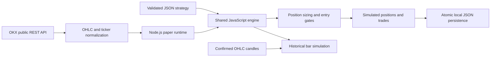

# Architecture and research assumptions

SignalForge is an early-stage configurable trading-strategy research project. The repository currently contains the indicator engine, a local paper-execution service, tests, and a reproducible command-line example. A visual web editor and exchange-side execution are planned.

## Components

### Shared strategy engine

`dist/engine.js` is a dependency-free ES module usable in Node.js and a future browser UI. A validated JSON schema configures instrument, timeframe, direction, confirmation mode, ALL/ANY condition logic, and risk parameters. Six condition types cover moving-average crosses, moving-average position, Parabolic SAR, RSI, relative volume, and MACD histogram direction. SMA and EMA are both supported. Indicators return unavailable values during warmup; conditions cannot pass on unavailable indicator values.

Intrabar moving-average crosses compare **two observed snapshots**, including the partially formed candle. This differs from merely checking whether price is currently above the moving average. A strategy configured for both directions suppresses ambiguous simultaneous long/short signals. The engine evaluates data only; it has no exchange credentials or order-submission capability.

### Market-data adapter and local runtime

`server.mjs` normalizes OKX public candles into chronological OHLCV records and validates ticker timestamps. An asynchronous loop polls every five seconds with a reentrancy guard. The runtime requires two valid snapshots, deduplicates entries by strategy and candle, enforces one position per instrument, and applies a cooldown after exit. Sampling can miss transient price movements between requests.

Position sizing is constrained by stop-distance risk and a leveraged margin budget. The local ledger estimates entry/exit fees and slippage, tracks fixed protective price levels, and pauses new entries after a UTC daily equity drawdown threshold. Pausing a strategy preserves monitoring of existing simulated positions. These protective levels exist in this local process; they are **not orders held at OKX**.

State is written to a temporary JSON file and atomically renamed. A serialized write queue prevents overlapping state writes. New entries are paused after restart; saved positions resume monitoring only when valid data is available. Runtime data and environment files are excluded from source control. The HTTP API binds to loopback and checks Host, Origin, JSON content type, and request-body size. It is not a multi-user Internet-facing service.

### Historical evaluation

The backtest derives signals from confirmed candles and fills at the next bar's open. It includes fixed per-side fee and slippage assumptions, adverse gap-stop fills, and stop-first treatment when a candle touches both protective levels. This avoids using future bars to generate the current signal, but does not recreate tick-level trading. Maximum drawdown is measured from sampled closing equity, not every intrabar excursion.

The paper runtime's daily limit includes unrealized P&L; the historical simulator's daily entry limit uses realized equity. Neither model includes funding, exchange liquidation rules, contract-lot rounding, order-book depth, partial fills, or production broker reconciliation. They are research approximations with different information sets, not interchangeable performance claims.

## Validation

Tests use Node's built-in `node:test` and `node:assert/strict`. They cover hand-calculated indicator outputs, warmup and causal behavior, intrabar snapshots, ALL/ANY logic, conflicting directions, position caps, fee accounting, adverse stop assumptions, stale-data rejection, deduplication, pause/restart behavior, persistence, and cross-site request guards. Fixtures are synthetic and explicitly labeled. Passing these tests establishes the covered behavior only; it does not validate profitability or live-trading readiness.

## Next development stages

1. Responsive visual strategy editor and charting interface.
2. More extensive indicator/reference-data validation and historical-data ingestion.
3. WebSocket data and recorded intrabar replay.
4. Secure OKX demo-trading adapter with contract metadata and account-mode validation.
5. Broker-side protective orders, order/fill reconciliation, retry handling, and operational monitoring.
6. Deployment and controlled acceptance testing before any live-trading capability.
